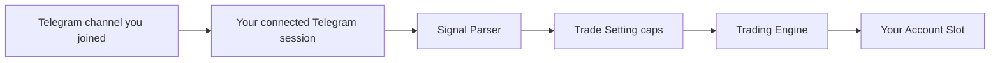

# Telegram-to-Trade

Telegram-to-Trade connects your Telegram account to MetaStation. Signals posted in the Telegram
channels you pick are parsed automatically and executed as trades on an account slot you choose.

---

## How it works



MetaStation reads new posts in the channels you link, through **your own Telegram session**. When a
post is a signal, it is parsed and sent to the slot's webhook like any other signal — so the slot's
**Trade Setting** applies to it too.

---

## Requirements

- An account slot with automation enabled — any MetaStation Account slot, or a Binance / ByBit /
  KuCoin slot with a Store plan
- A Telegram account
- Membership of the signal channel (your own, or one you have joined)

---

## Setup

### 1. Connect your Telegram account

{/* SCREENSHOT: tg-connect | Automation -> Telegram connection tab, phone-number state | 1440x900 | redact: phone number */}

1. Open **Automation** in the sidebar and switch to the **Telegram connection** tab
2. Enter your **Phone Number** with country code (e.g. `+1 234 567 8900`)
3. Click **Connect Telegram**
4. Telegram sends a code to your Telegram app — enter it under **Verification Code**
5. If your *Telegram* account has its own two-step verification, enter that **2FA Password** next.
   This is Telegram's password, not your MetaStation one

Once connected, the card reads **Telegram Connected** and shows how many channels were detected and
how many are set to copy trade or broadcast.

:::warning
Your Telegram session is stored encrypted, and MetaStation does not read your private messages.
Never share your Telegram login code with anyone — MetaStation support will never ask for it.
:::

### 2. Find the channel

{/* SCREENSHOT: tg-channel-binding | connected state with channels detected + channel selector | 1440x900 | redact: channel names optional */}

Channels you have **joined with this Telegram account** are listed automatically. Joined a new one?
Press **Refresh Channels** and it appears.

### 3. Map the channel to an account slot

1. Open the account card for the slot you want to trade on
2. Press **Add Channel**, then **Select Signal Channel** (to copy its trades) or **Select Broadcast
   Channel** (to post your trades there)
3. Save. The channel shows as **Listening**

:::note[Channel limit]
Copy trades from up to **3 signal channels per account slot**. Map different channels to different
slots if you need more sources.
:::

---

## Controls per channel

Edit a channel on the account card:

| Setting | Options |
|---|---|
| **Status** | **Listening** — new signals are traded; or paused — signals are ignored until you resume |
| **Who can trigger trades** | Anyone who posts in the channel · Channel admins only · Bots only · Pinned messages only |

Sizes and leverage are capped by the slot's **Trade Setting** on the Automation page — a maximum
leverage, a maximum percentage of balance or USD value, and a default size for signals that name
none. → [Risk Controls](/docs/concepts/risk-controls)

---

## Signal parsing

MetaStation's parser reads natural-language signals and extracts the side, the market, the entry,
take-profit levels, the stop loss and the leverage.

**Example signal the parser handles:**

```
📈 LONG BTC/USDT
Entry: Market
TP1: 48000
TP2: 51000
SL: 41000
Leverage: 10x
```

If a signal is ambiguous or missing required fields, it is not executed — the parser never guesses.

→ [Natural Language Format](/docs/developer/natural-language-format)

### Edits, deletions and duplicates

- **Edited** in the channel before it is placed: the signal is amended to the new text
- **Deleted** before it is placed: the signal is withdrawn
- The **same call posted in two of your channels** is placed once
- A post written as a stop or trigger order is refused

---

## Monitoring

- **History → Signal History** — every signal, its **Processing Status** and, if it did not execute,
  the **Reason**
- **Results by channel** on the account card — each channel's signals and results

---

## When the plan ends

On a Binance, ByBit or KuCoin slot, channels pause automatically when the slot's plan expires.
Renewing does not resume them — set each back to **Listening** once the plan is active.

---

## Managing the connection

The **Telegram connection** tab shows your linked session. **Disconnect** ends it — signal parsing
stops immediately — and you can reconnect any time by repeating the phone-number flow.

:::note[Not the same as MetaStation in Telegram]
Telegram-to-Trade reads signal channels. Using the MetaStation app inside Telegram, through
@MetaStationBot, is separate. → [MetaStation in Telegram](/docs/getting-started/telegram)
:::
