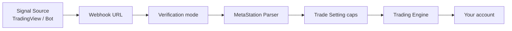

# Webhook Trading

Webhooks let external services — TradingView, custom bots, or any HTTP source — send trading signals to MetaStation for automatic execution.

---

## How it works



When your signal source fires an alert, it sends a POST request to your slot's webhook URL.
MetaStation checks it against the slot's verification mode, reads the message, applies the slot's
caps, and executes the trade on that slot.

---

## Setup

### 1. Open Automation

Click **Automation** in the sidebar —
[metastation.fi/social-trade/automation](https://metastation.fi/social-trade/automation).
The page has two tabs — **Signal sources** and **Telegram connection**. Stay on **Signal sources**;
its **Your Webhook URLs** section lists one webhook URL per account slot you can automate.

{/* SCREENSHOT: webhook-urls | Automation -> Signal sources -> Your Webhook URLs | 1440x900 | redact: WEBHOOK TOKEN (mandatory) */}
<Screenshot id="webhook-urls" />
{/* SCREENSHOT: regenerate-secret | Regenerate Secret confirm state | 1440x900 | redact: webhook token */}
<Screenshot id="regenerate-secret" />

:::tip[Build the payload instead of writing it]
The **[Webhook Payload Builder](/docs/developer/payload-builder)** generates a valid JSON payload,
a TradingView alert message and a ready-to-run `curl` command from a form.
:::

:::note
Webhook automation is **included free** on every MetaStation Account slot. For Binance, ByBit, or
KuCoin slots, a Store plan is required.
:::

### 2. Copy your webhook URL

1. Find the account slot you want to automate under **Your Webhook URLs**
2. Press **Show the webhook URL**, then **Copy** — it looks like:

```
https://metastation.fi/metastationapi/socialTrade/webhook/{your-webhook-secret}
```

3. Store it securely. Treat it like a password
4. If it ever leaks, press **Regenerate Secret** on that slot. The old URL stops working
   immediately. You can regenerate at most once every 24 hours

### 3. Choose the verification mode

| Mode | Use it for |
|---|---|
| **URL only** | Quick tests. Anyone who has the URL can send signals |
| **Signed requests** | Your own scripts and bots. Press **Generate signing key**; every request must then carry an `X-MetaStation-Signature`. The page shows how to sign, in curl, Node.js and Python |
| **Source-address check** | TradingView alerts, which cannot sign. Only requests from TradingView's published addresses are accepted |

Real-money followers can copy a provider's product only when its webhook uses **Signed requests**
or the **Source-address check**.

→ [Secure Your Webhook](/docs/guides/secure-your-webhook)

### 4. Set the slot's Trade Setting

Press **Trade Setting** on the slot to cap what any signal can do: a maximum **Leverage**, a maximum
**Percentage of Balance (%)** or **USD in Value**, and turn on **Use this as maximum risk setting**.
A signal with no size uses these as its size.

→ [Risk Controls](/docs/concepts/risk-controls)

### 5. Send signals

Send POST requests to your webhook URL in [JSON format](/docs/developer/json-format) or
[Natural Language format](/docs/developer/natural-language-format).

---

## Supported actions

| Action | Description |
|---|---|
| `open` | Open or add to a position |
| `close` | Close the position in that market (full or partial) |
| `target` | Hold `long`, `short` or `flat` — one message flips a position |
| `cancel` | Withdraw followers' copy entries that have not filled |

→ [Supported Actions](/docs/developer/supported-actions)

---

## Viewing signal history

Open **History → Signal History** to see every signal the slot received: when, what it was read as,
its **Processing Status**, and the **Reason** when it did not execute as sent. The slot's row on
the Automation page also shows its **Total Signals**.

{/* SCREENSHOT: webhook-history | History -> Signal History | 1440x900 | redact: account ids */}
<Screenshot id="webhook-history" />

---

## Testing your webhook

Start with a **dry run** — it returns what would be placed and places nothing:

```bash
curl -X POST "$METASTATION_WEBHOOK_URL?dryRun=1" \
  -H "Content-Type: application/json" \
  -d '{"action":"open","symbol":"BTCUSDT","side":"buy","orderType":"market","quantity":"1%"}'
```

Then send one real signal at a small size and verify the trade appears in your account before going
live.

---

→ [JSON Format Reference](/docs/developer/json-format)
→ [Natural Language Format](/docs/developer/natural-language-format)
→ [TradingView Setup](/docs/automation/tradingview-setup)
