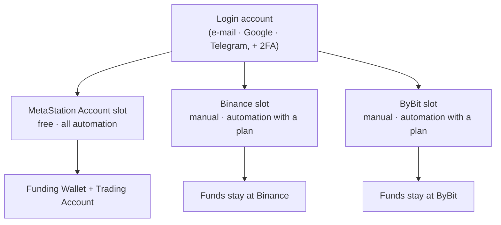

import ArticleSchema from '@site/src/components/ArticleSchema';
import FAQ from '@site/src/components/FAQ';

<ArticleSchema
  headline="The MetaStation Account Model — Accounts, Slots and Wallets"
  description="How MetaStation separates the login account, trading slots, and the wallets that hold funds."
  section="Concepts"
/>

# The Account Model

Three things in MetaStation are easy to confuse because everyday language calls all of them
"your account". They are separate, and almost every question about where money sits or why a
feature is unavailable resolves once the distinction is clear.

| Layer | What it is | How many |
|---|---|---|
| **Login account** | Your identity — what you sign in with: e-mail and password, Google, or Telegram, plus 2FA | Exactly one |
| **Trading slot** | One trading configuration: a venue, its balance, its settings, its automation | One or many |
| **Wallets** | The Funding Wallet and Trading Account behind a MetaStation Account slot | Per MetaStation Account slot |

---

## The login account

It owns everything below it and is not itself a place where money sits. You can sign in with:

- **E-mail and password**
- **Google**
- **Continue with Telegram** — your Telegram account, or your Telegram wallet

An account created with Telegram can add an e-mail and password later, so you can also sign in on
the web without Telegram. Whatever you sign in with, turning on an **authenticator app** protects
every sign-in and every withdrawal.

→ [Create an Account](/docs/getting-started/create-account) · [Security Setup](/docs/getting-started/security-setup)

---

## Trading slots

A **slot** is the unit of trading configuration. Each one is independent: its own balance, its
own leverage defaults, its own automation rules, its own webhook URL. A signal sent to one
slot's webhook cannot touch another slot.

Slots come in two kinds, and the difference decides what a slot can do.

### MetaStation Account slots

Native to the platform; your first one is created at registration. **Web3 by default** — it trades
on-chain in USDC against an on-chain order book.

- **Every MetaStation Account slot is free** and carries **every automation tool** at no cost
- There is no cap on how many you hold. Before you add another, each one you already have must be
  **activated** — first deposit made, activation fee paid, **Enable Trading** done

### Connected exchange slots

Binance, ByBit and KuCoin, connected with API keys you generate at that exchange. MetaStation
places orders with the keys; the funds never leave the exchange.

- There is no cap on how many you add. Before you add another slot on the same exchange, every slot
  you already have there must have **working API keys**
- Terminal trading and following copy-trading providers work on any slot
- **Automation** — webhooks and Telegram-to-Trade — needs a **paid plan** for that slot, bought in
  the **Store**

**This is the single most important asymmetry in the product:** automation is free on the native
account and paid on connected exchanges. If you are evaluating MetaStation for webhook trading
and do not want a subscription, the MetaStation Account slot is the answer.

→ [Account Slots](/docs/trading/account-slots) · [Connect an Exchange](/docs/trading/connect-exchange)

---

## The wallets behind a MetaStation Account

| Wallet | What it holds |
|---|---|
| **Funding Wallet** | Where deposits land — USDC on Arbitrum One. Created for you; no seed phrase |
| **Trading Account** | The balance you trade from: USDC margin and spot coins |

The account's **first deposit** into the Funding Wallet activates it: a one-time activation fee is
taken and the rest moves into the trading balance. After that, **Enable Trading** once and the
account is ready. Funds are never pooled with other users'.

Connected exchange slots have **no** MetaStation wallets. Their balance is your balance at that
exchange; the Deposit page shows the exchange's own address, and withdrawals are made on the
exchange.

→ [Funding & Settlement](/docs/concepts/funding-and-settlement)

---

## Why a feature is unavailable

Nearly every "why can't I do this?" traces back to which slot is selected:

| Symptom | Cause |
|---|---|
| No webhook URL for a slot | It is an exchange slot with no plan. Automation needs a Store plan |
| Telegram tab shows no slot to map | Same — the target slot has no automation entitlement |
| Orders refused on a new MetaStation Account | It is not activated or trading is not enabled yet |
| Cannot add another MetaStation Account | An existing one is not activated yet |
| Cannot add another exchange slot | An existing slot on that exchange has no working API keys |
| Withdraw shows an exchange notice | Funds on a connected exchange are withdrawn on the exchange itself |

<FAQ
  items={[
    {
      question: 'What is the difference between a MetaStation Account and a trading slot?',
      answer:
        'A MetaStation Account is one type of trading slot — the native, Web3 one; your first is created at registration. "Slot" is the general term for any single trading configuration, which may also be a connected Binance, ByBit or KuCoin account. Your login account can hold several slots of both kinds at once.',
    },
    {
      question: 'Do I need my own crypto wallet to use MetaStation?',
      answer:
        'No. A MetaStation Account comes with a Funding Wallet created for you, with no seed phrase to record. You only need a wallet of your own to bridge from another network, and you can also send USDC on Arbitrum One to the Funding Wallet from any exchange.',
    },
    {
      question: 'Is webhook automation free on MetaStation?',
      answer:
        'It is free on every MetaStation Account slot, along with Telegram-to-Trade, copy trading and advanced orders. On a connected Binance, ByBit or KuCoin slot, automation needs a paid plan for that slot from the Store; those slots are free for manual trading and for following copy-trading providers.',
    },
    {
      question: 'Where do my funds sit when I connect Binance to MetaStation?',
      answer:
        'They stay at Binance. Connecting an exchange means giving MetaStation API keys that let it place orders on your behalf — no funds move to MetaStation. Withdrawals for that slot are made on the exchange itself.',
    },
    {
      question: 'Can one webhook signal trade on several accounts at once?',
      answer:
        'No. Each slot has its own webhook URL, and a signal executes only on the slot whose URL received it. To trade the same signal on several slots, send it to each slot’s URL.',
    },
  ]}
/>
