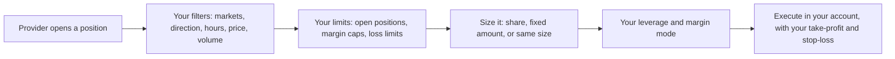

import ArticleSchema from '@site/src/components/ArticleSchema';
import FAQ from '@site/src/components/FAQ';

<ArticleSchema
  headline="How Copy Trading Executes on MetaStation"
  description="How a provider's trade is translated to your account, which controls sit in the path, and why results never match exactly."
  section="Concepts"
/>

# How Copy Trading Executes

Copy trading looks like duplication. It is closer to **translation**: the provider's trade is
restated in the terms of your account, and the settings you chose change it — or stop it — on the
way.

MetaStation Social Trade is a copy-trading service. Signal Providers, Fund Managers and Strategies
trade their own accounts; MetaStation copies their trades into **yours**, according to the settings
you choose. MetaStation does not manage your funds — your money stays in your own account, and you
can stop copying at any time.



---

## Every kind of provider executes the same way

- A **signal provider** publishes signals from a webhook or a Telegram channel.
- A **fund manager** trades their own account, and its trades are copied as they are made.
- A **strategy** is a tracked record, copied as its own single-strategy index.

Downstream of the trade, nothing differs: the same sizing, the same limits, the same execution into
your account. What differs is how the provider is paid.

→ [Fund Managers](/docs/social-trading/fund-managers) · [Indexes](/docs/social-trading/indexes)

---

## Sizing

There is no multiplier. Size is decided by how you chose to size each copy:

| Mode | What it does |
|---|---|
| **A share of each trade** | A percentage of the provider's order size — **0.01% to 100%** |
| **A fixed amount per trade** | This many **dollars** of the coin on every copy |
| **The same size as the provider** | The provider's own order size |

**A share cannot exceed 100%.** You cannot take a larger position than the provider did.

This is why `1.0x`-style thinking misleads. A provider trading a $100,000 account at $5,000 a
position is risking 5%. Mirrored into a $5,000 account at **the same size**, that $5,000 position is
your entire balance. The share that reproduces their *risk* rather than their notional is:

```
share % = (your balance / provider balance) × 100
```

A $2,000 account following a $20,000 provider is `10%`.

---

## What sits between the provider and you

All of these are yours, set on the copy page and editable later:

| Control | Effect |
|---|---|
| **Leverage** | Your account's leverage for that market, or one you set. **Never the provider's** |
| **Margin mode** | Isolated or Cross |
| **Loss limit** and **trailing stop** | Stop copying after a loss — and close, keep, or close-with-the-provider the open copies |
| **Daily loss limit** | Stop for the day after losing this much |
| **Markets** and **direction** | Only these markets, all but these, long only, short only |
| **Position and margin caps** | At most N open positions; at most this much margin in one market, or in all open copies |
| **Take profit / stop loss** | Your own, per copy, in ROI % or dollars — replacing the provider's |
| **Copy only trades with a stop-loss** | A signal without one is not opened |
| **Price, volume, hours, cooldown, end date** | Skip illiquid markets, copy only in your hours, space out openings |

Filters apply to **openings**. A close always copies, so a position is never stranded by a filter.

→ [Copy Settings](/docs/social-trading/copy-settings)

---

## Countertrading

A copy can take the **opposite** side: the provider's long is your short. You choose **Copy** or
**Countertrade** when you subscribe, and the choice is fixed.

A countertrade has the provider's timing with the opposite exposure: when their trade gains, yours
loses. Only **market** entries are countered — a limit or stop entry, or a trade managed with several
take-profits, a trailing stop or a break-even rule, is not copied. A countertrade needs a loss limit.

---

## Why your result will not match theirs

Copied results will not match the provider's exactly, and they can differ between followers:

- **Fills.** In fast markets not every follower's order may be filled, or filled in full.
- **Slippage.** Your order can fill at a different price than the provider's.
- **Latency.** Your order is placed after the provider's trade is seen, so the price may have moved.
- **Volatility.** Sharp price moves between the provider's trade and yours change the outcome.
- **Different markets.** A provider may trade on a different market than the one your account uses;
  prices, fees, liquidity and timing there differ.
- **Size.** Very small or very large allocations can track a provider less closely.

Your own limits change it too: a copy can be **made smaller** or **not copied** by them, and **My
copies → Activity** shows each one with the reason. And you join mid-stream — positions the provider
already held when you subscribed are not copied.

A tracked strategy's opening is skipped when the price has moved more than 0.5% against the
provider's fill; exits are never held.

:::note[What is not copied]
Manual trades you place yourself are yours alone. Your loss limit counts — and closes — only this
subscription's copies, never your own trades. Keeping copied and manual trading in separate
accounts is the cleanest way to keep the two accountings apart.
:::

---

## Concentration is the risk that actually shows up

The failure mode in copy trading is rarely one bad trade. It is following several providers who all
take the same directional bet, so a single market move hits every position at once while the
portfolio looked diversified.

Practical guards, in descending order of usefulness:

1. A **loss limit** on every subscription.
2. Cap any single provider at a fraction of total capital — a common starting point is 30%.
3. Check whether providers overlap — the browse labels those trading the **same basket as others**.
4. **Copy only trades with a stop-loss**, and cap open positions.

<FAQ
  items={[
    {
      question: 'How is my copied position size decided?',
      answer:
        'By how you chose to size each copy: a share of each trade (0.01%–100% of the provider’s order size), a fixed dollar amount per trade, or the same size as the provider. No setting can take a larger position than the provider did.',
    },
    {
      question: 'Does copy trading stop automatically if a provider starts losing money?',
      answer:
        'Yes, if you set a loss limit or a trailing stop. When it is reached, copying stops and the open copies are closed, kept open, or closed with the provider, as you chose. You can also set a daily loss limit. The subscription stays stopped until you re-arm it.',
    },
    {
      question: 'Can I stop a provider copying particular markets to my account?',
      answer:
        'Yes. Copy only the markets you list, or all but the ones you list, and choose long only or short only. Filters apply to openings; closes always copy.',
    },
    {
      question: 'What is countertrading?',
      answer:
        'Taking the opposite side of each of the provider’s trades. It is chosen at subscribe and fixed, needs a loss limit, and counters market entries only.',
    },
    {
      question: 'Whose leverage is used for my copies?',
      answer:
        'Yours. Each copy opens at the leverage your account already has for that market, or at a leverage you set. The provider’s leverage is never used.',
    },
    {
      question: 'Are my own manual trades affected by copy trading?',
      answer:
        'No. Trades you place yourself are not managed by the provider, are not counted by your loss limit, and are never closed by it.',
    },
  ]}
/>
