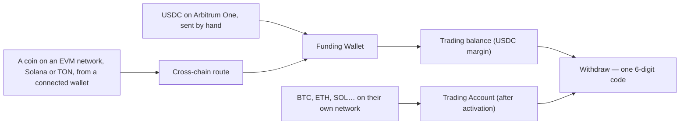

import ArticleSchema from '@site/src/components/ArticleSchema';
import FAQ from '@site/src/components/FAQ';

<ArticleSchema
  headline="Funding and Settlement on MetaStation"
  description="The Funding Wallet, activation, USDC as margin, how profit and loss settle, transfer costs, and how withdrawals are confirmed."
  section="Concepts"
/>

# Funding and Settlement

Money entering a MetaStation Account follows one of two paths, and the Deposit page always names
which wallet you are sending to. Following them end to end explains both the convenience and the
one place where waiting is normal.

---

## Two wallets per account

| Wallet | What it is | What it takes |
|---|---|---|
| **Funding Wallet** | A wallet on Arbitrum One that MetaStation creates with your account. No seed phrase to store | USDC on Arbitrum One sent by hand, or a bridged deposit from a connected wallet |
| **Trading Account** | The balance you trade from — USDC margin, plus spot coins | After activation: BTC, ETH, SOL and other coins straight on their own network |

You move money between them, and between your own accounts, with **Transfer** on the Wallet page.

→ [Deposit](/docs/wallet/deposit) · [Cross-Chain Deposits](/docs/wallet/cross-chain-exchange)

---

## Activation: the first deposit

A new MetaStation Account is activated by its **first deposit into the Funding Wallet**. That
deposit:

- must meet the **minimum** shown on the Deposit page
- pays a **one-time activation fee**, also shown there before you send
- moves the rest into your trading balance automatically

After that, press **Enable Trading** on the account once, and you can trade. Both steps are once
per account, never per trade.

---

## USDC as the unit of account

Margin is USDC, profit and loss on perpetual futures are USDC, and fees are USDC. A position closed
at +$180 adds $180 to the balance.

Spot is the exception by nature: buying BTC on spot, or depositing BTC into the Trading Account,
leaves you holding BTC.

For perpetual futures, funding payments also settle in USDC and accrue against the position while
it is open — a cost of holding, independent of whether price moved your way. **History → Funding
Payments** lists them, and the futures header shows the predicted funding for the next hour.

---

## What moving money costs

| Movement | Cost |
|---|---|
| **Placing and cancelling orders** | No network gas. You never hold a gas token to trade |
| **Activation** | The one-time fee, taken from the first deposit |
| **Transfers** between wallets and accounts | A small network fee in USDC, shown before you confirm |
| **Withdrawals** | A flat withdrawal fee plus a network fee, shown on the quote |
| **Bridged deposits** | The route's cost is in the quote; the source chain's gas is paid from your own wallet |

---

## Deposits take as long as the chain does

The step that takes time is confirmation on the **source** network, not MetaStation. A deposit is
not lost while it is in transit; it is confirming.

If a deposit has not appeared:

1. Confirm the transaction is finalised on the **source** chain — that is where the wait is.
2. If you sent by hand, confirm it was **USDC on Arbitrum One**. Anything else sent by hand to the
   Funding Wallet address is lost.
3. Look under **Deposits in progress** on the Deposit page. A bridged deposit delayed on the network
   can be sent back with **Refund delayed deposit**.

---

## Withdrawals are confirmed by a code

A withdrawal is the only action that moves value off the platform irreversibly, so every one is
confirmed with a **6-digit code**, tied to that withdrawal's destination and amount, valid for 5
minutes and usable once.

The code comes from your **authenticator app** if you have one turned on. Otherwise it is sent by
**e-mail** (or by our **Telegram bot**, for an account with no e-mail), and sent codes cover at most
**$1,000 of withdrawals in 24 hours**. Five wrong codes lock withdrawals for 15 minutes.

→ [Withdrawal Security](/docs/security/withdrawal-whitelist) · [Two-Factor Authentication](/docs/security/two-factor-auth)

:::note[Connected exchange slots work differently]
Everything above describes a MetaStation Account. A connected Binance, ByBit or KuCoin slot has no
Funding Wallet — the funds are your balance at that exchange. The Deposit page shows the
exchange's own deposit address; withdrawals are made on the exchange itself.
:::

<FAQ
  items={[
    {
      question: 'Which blockchains can I deposit from on MetaStation?',
      answer:
        'By hand, USDC on Arbitrum One into the Funding Wallet. From a connected wallet, coins on Ethereum and its Layer 2s, EVM chains, Solana and TON, bridged to the Funding Wallet as USDC. After activation, BTC, ETH, SOL and some other coins straight into the Trading Account on their own network.',
    },
    {
      question: 'Do I need ETH for gas to trade on MetaStation?',
      answer:
        'No. Placing and cancelling orders costs no network gas, so you never hold a separate gas token to trade. Moving money between wallets, or withdrawing, carries a small network fee in USDC that is shown before you confirm.',
    },
    {
      question: 'Is there a fee to open a MetaStation Account?',
      answer:
        'The account is free to create. It is activated by its first deposit, which pays a one-time activation fee shown on the Deposit page before you send.',
    },
    {
      question: 'What do I need to withdraw funds from MetaStation?',
      answer:
        'One 6-digit code per withdrawal: from your authenticator app if you have one, otherwise a code sent by e-mail. Codes sent by e-mail cover at most $1,000 of withdrawals in 24 hours, so turning on an authenticator app is the way to withdraw larger amounts.',
    },
    {
      question: 'Do I get a seed phrase for my MetaStation Funding Wallet?',
      answer:
        'No. The Funding Wallet is created for you with your MetaStation account, so there is no phrase to write down or lose. The trade-off is that your account security is your wallet security, which is why every withdrawal is confirmed with a code.',
    },
  ]}
/>
