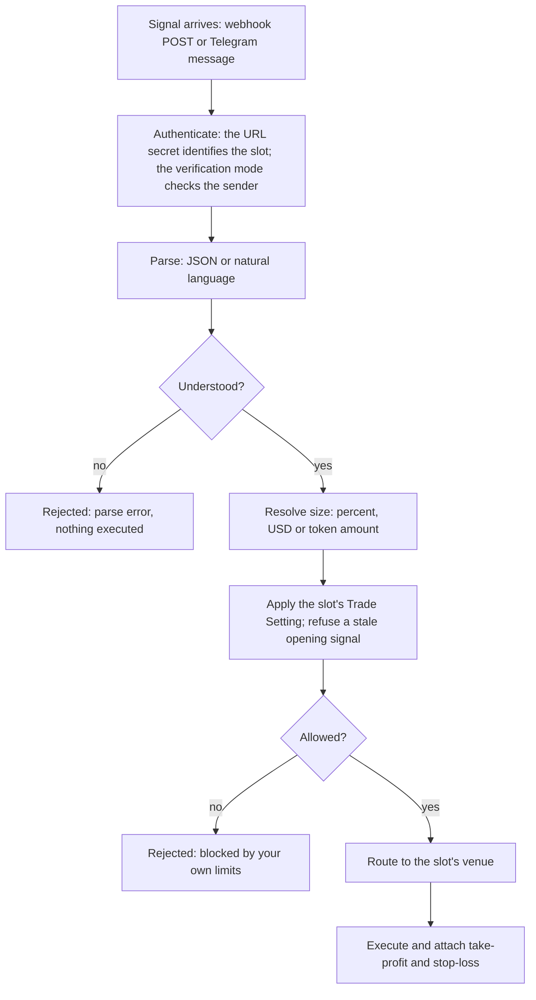

import ArticleSchema from '@site/src/components/ArticleSchema';
import FAQ from '@site/src/components/FAQ';

<ArticleSchema
  headline="How a Signal Becomes a Trade on MetaStation"
  description="The path a webhook or Telegram signal takes from arrival to fill, and every point at which it can be rejected."
  section="Concepts"
/>

# How a Signal Becomes a Trade

Every automated trade on MetaStation — whether it arrives from a TradingView alert, a Telegram
channel, or your own script — travels the same path. Understanding it tells you exactly where to
look when a signal does not do what you expected.



---

## 1. Arrival and authentication

A webhook signal is a `POST` to a URL that ends in a token unique to one slot:

```
https://metastation.fi/metastationapi/socialTrade/webhook/{your-webhook-secret}
```

**The secret in the URL identifies the slot.** There is no account field in the payload; routing
is entirely a function of which URL received the request.

What else a request must carry depends on the slot's **verification mode**:

| Mode | What is checked |
|---|---|
| **URL only** | Nothing else — anyone holding the URL can trade the slot |
| **Signed requests** | An `X-MetaStation-Signature` HMAC of the body with your signing key, within 300 seconds, used once |
| **Source-address check** | The request comes from TradingView's published addresses |

A Telegram signal is read from your own Telegram session in a channel you linked to the slot, and
delivered to the same webhook with the slot's secret — so it goes through the same pipeline.

→ [Secure Your Webhook](/docs/guides/secure-your-webhook)

## 2. Parsing

Two formats are accepted on the same endpoint, and the parser detects which one it is looking at.

**JSON** is explicit and unambiguous — the right choice for anything you generate yourself:

```json
{ "action": "open", "symbol": "BTCUSDC", "side": "buy", "quantity": "2%" }
```

**Natural language** is for signals written by humans, which is what Telegram channels and
hand-written TradingView alerts actually contain:

```
LONG BTC/USDT
Entry: Market
TP1: 48000
SL: 41000
```

From either form, the parser extracts action, symbol, direction, size, entry, take-profit levels,
stop loss and leverage.

:::note[It never guesses]
If a signal is ambiguous or missing a required field, MetaStation logs a parse error and executes
nothing. This is deliberate: a wrong trade is far more expensive than a missed one, and a parser
that fills in blanks would eventually fill one in wrongly with real money.
:::

→ [JSON Format](/docs/developer/json-format) · [Natural Language Format](/docs/developer/natural-language-format)

## 3. Size resolution

Size can be expressed three ways, and they behave differently as your balance changes:

| Form | Example | Resolves to |
|---|---|---|
| Percentage | `"2%"` | 2% of the slot's wallet balance **at the moment the signal arrives** |
| USD value | `"300 USD"` | $300 of notional. `"$300"` is not accepted |
| Token amount | `0.001` or `"0.001 BTC"` | Exactly that many tokens |

The percentage form is the one that surprises people: it compounds. A `2%` strategy takes larger
positions as the account grows and smaller ones as it shrinks, without any change to the alert.
A fixed USD amount does not.

## 4. Risk controls

Before anything is routed, the signal is checked against the slot's **Trade Setting** — a maximum
leverage (0–100×), a maximum percentage of balance and a maximum USD value — and its age:

- The caps **reduce** the signal rather than reject it: a slot capped at 5x executes a `20x` signal
  at 5x, and an oversized signal is cut to the cap
- A signal that names **no size** takes the slot's percentage or USD value as its size
- An **opening** signal more than **90 seconds** old is refused — measured from the signal's own
  `timestamp` when it sends one. A close is never refused for age
- The same request repeated within **60 seconds** runs once

Market filters and maximum open positions belong to **copy subscriptions**, not to a slot's own
signals. → [Copy Settings](/docs/social-trading/copy-settings)

→ [Risk Controls](/docs/concepts/risk-controls)

## 5. Routing and execution

The order is placed on whatever venue backs the slot — the on-chain order book for a MetaStation
Account, or Binance / ByBit / KuCoin through your API keys for a connected slot.

Take-profit levels and the stop loss in the signal are attached with the order. When the entry is a
resting limit order, they are placed **when it fills**, sized to the fill. If a stop cannot be
placed, the position is closed rather than left unprotected. SLX is set on the order ticket, not by
webhook.

→ [Order Execution](/docs/concepts/order-execution)

---

## When a signal does nothing

Work down this list in order — it matches the pipeline above, so the first failing step is the
answer:

| Check | Meaning |
|---|---|
| Did the sender get a `200`? | A `400` means the body was not understood; a `401`, the verification mode refused it; a `403`, the slot has no automation; a `404`, the URL is out of date |
| Does it appear in **History → Signal History**? | If not, it never arrived |
| Is it listed but not executed? | Its **Reason** says why — too old, no size, or refused by the exchange |
| Did it execute at the wrong size? | Check which size form the signal used, and the slot's Trade Setting caps |

{/* SCREENSHOT: signal-trace | History -> Signal History, one signal with its status and reason | 1440x900 | redact: account ids, webhook token */}
<Screenshot id="webhook-history" />

<FAQ
  items={[
    {
      question: 'Why did my TradingView alert not execute a trade?',
      answer:
        'Check History → Signal History first. If the signal is not listed, it never arrived — verify the alert’s webhook URL, and that the slot’s verification mode accepts TradingView (Source-address check or URL only). If it is listed but did not execute, its Reason says why: an opening signal that arrived more than 90 seconds late, a missing size, or a refusal by the exchange.',
    },
    {
      question: 'Does MetaStation guess missing values in a trading signal?',
      answer:
        'No. If a signal is ambiguous or missing a required field, MetaStation logs a parse error and executes nothing. Silently filling in a missing side, symbol or size would eventually produce a wrong trade with real money, so the parser refuses instead.',
    },
    {
      question: 'What does a quantity of 2% mean in a webhook signal?',
      answer:
        'It means 2% of that slot’s wallet balance, calculated at the moment the signal arrives. It compounds — the same alert takes larger positions as the account grows and smaller ones as it shrinks. Use a fixed USD amount such as "300 USD" instead if you want constant position sizing.',
    },
    {
      question: 'How does MetaStation know which account a webhook signal should trade?',
      answer:
        'From the URL. Each trading slot has its own webhook URL ending in a unique secret, and the signal executes on the slot that owns the URL it was sent to. The payload contains no account field.',
    },
    {
      question: 'Can I send trading signals in plain English instead of JSON?',
      answer:
        'Yes. The same webhook endpoint accepts natural-language signals of the kind Telegram channels post — action, symbol, entry, take-profit levels, stop loss and leverage are extracted from the text. JSON is better for signals you generate programmatically because it is unambiguous.',
    },
  ]}
/>
